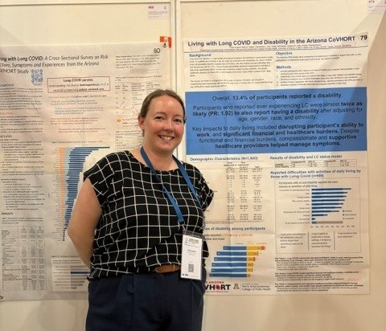
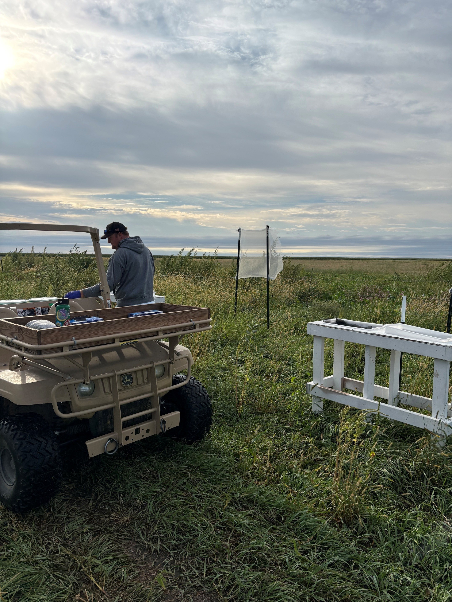
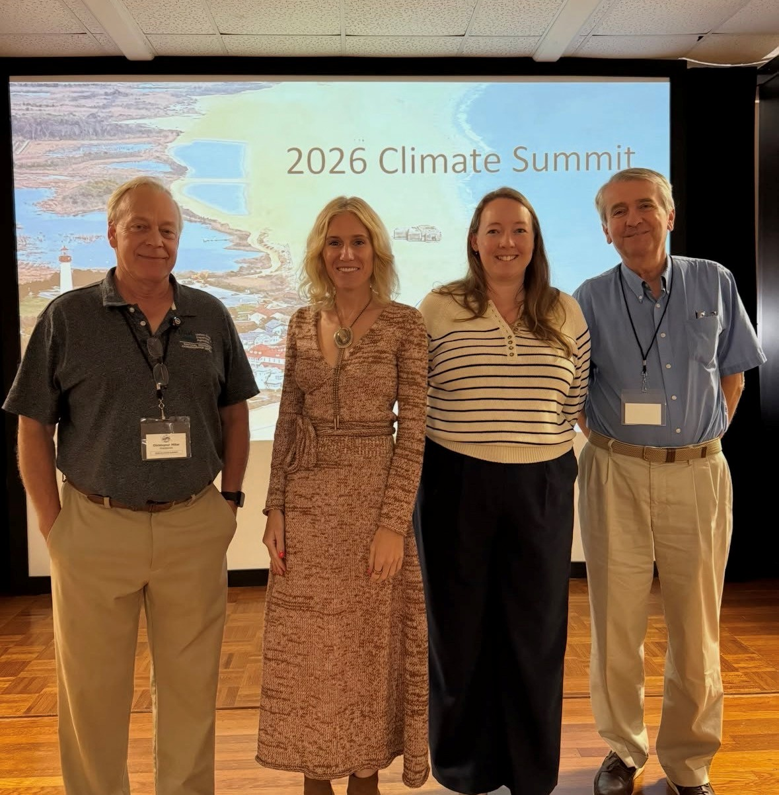

# Research Interests

My research focuses on the intersection of climate change and health. I focus on epidemiological study design and data science approaches in my research which has allowed me to explore a variety of climate change health outcomes and infectious diseases and their long term health outcomes.

# Current Work

- Risk of enteric diseases following post-wildfire flooding (UA Catalyst Early Career Research Award, 2026-2027, PI)

- Exploring transmission dynamics of *Salmonella* through shotgun metagenomics and whole genome sequencing (UAHS Career Development Award 2025-2027, PI)

- Exploring transmission of pathogens from cattle feedlots to adjacent lands (Center for Produce Safety 2025-2027 Grant, co-PI)

- Produce safety risks following application of Biological Soil Amendments of Animal Origin (BSAAOs) (Center for Produce Safety 2026-2028 Grant, co-PI)

- Gastrointestinal symptoms and health outcomes of COVID-19 (NIH NIDDK R01, co-I)

- Cardiovascular health outcomes of wildfire smoke exposure (CLIMAS NOAA RISA grant)

- Technical assistance to health departments responding to the health effects of climate change (BRACE, CDC)

## Thinking about...

- Health effects following dual or cascading natural hazards

- How migratory birds contribute to infectious diseases spread and persistence in the environment

# Research in Real Life!

Presenting at the 4th International Long COVID Conference in Nice, France, November 2026

Field sampling at the US-MARC in Clay Center, NE with our post-doc Jared Smith, September, 2026

{width="423"}

Speaking at the Cape May Arts and Science Center Climate Summit, 2026

{width="546"}
